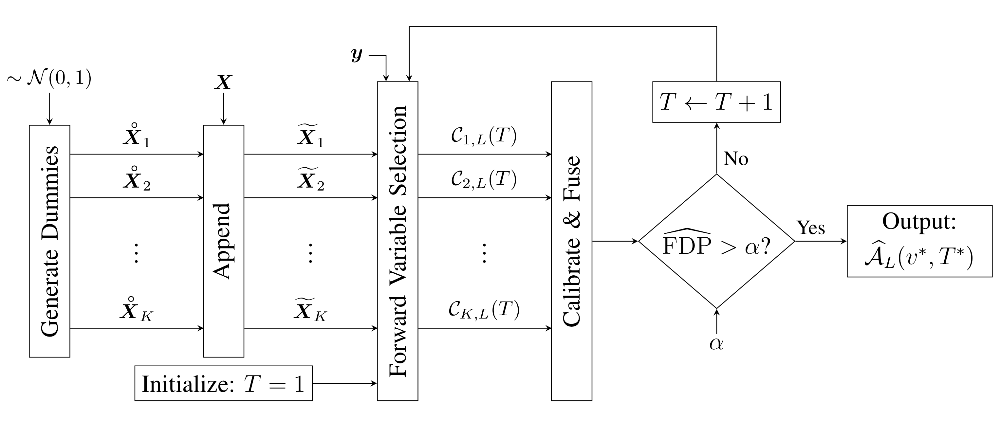
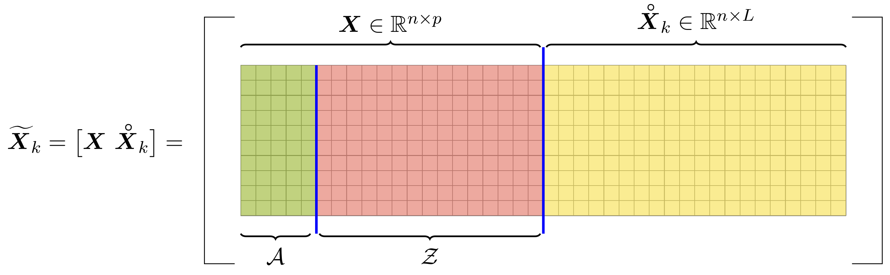

```{r setup, include = FALSE}
knitr::opts_chunk$set(collapse = TRUE, comment = "#>", fig.align = "center",
                      fig.width = 6, fig.height = 4)
options(width = 80)
library(TRexSelector)
old_threads <- trex_set_num_threads(min(2L, trex_get_max_threads()))
```

# FDR and TPR

Let $\widehat{\mathcal{A}} \subseteq \{1, \ldots, p\}$ be the set of selected variables and
$\mathcal{A}$ the set of true active variables. With $1 \vee a = \max\{1, a\}$, the false discovery
rate (FDR) and the true positive rate (TPR) are

$$
\operatorname{FDR} = \mathbb{E}\left[\frac{|\widehat{\mathcal{A}} \setminus \mathcal{A}|}
{1 \vee |\widehat{\mathcal{A}}|}\right],
\qquad
\operatorname{TPR} = \mathbb{E}\left[\frac{|\mathcal{A} \cap \widehat{\mathcal{A}}|}
{1 \vee |\mathcal{A}|}\right].
$$

The quantities inside the expectations are the false discovery proportion (FDP) and the true positive
proportion (TPP) of one selection. `trex_fdp()` and `trex_tpp()` compute them from index sets,
`trex_fdp_dense()` and `trex_tpp_dense()` from coefficient vectors. The T-Rex selector controls the FDR
at the target `tFDR` and maximizes the number of selected variables under that constraint
[@machkour2025trex].

# The framework

```{r framework, echo = FALSE, fig.cap = "Figure 1: The T-Rex framework.", out.width = "85%"}

```

The selector runs $K$ random experiments. In experiment $k$ the design $\boldsymbol{X}$ ($n \times p$)
is enlarged by a dummy matrix with $L \cdot p$ columns drawn independently of the data, a forward
selection solver walks the solution path of the enlarged design, and the path is terminated as soon as
$T$ dummies have entered the model. The dummies are a negative control group. A null variable and a
dummy are exchangeable along the path, so the number of included dummies estimates the number of
included null variables.

```{r enlarged, echo = FALSE, fig.cap = "Figure 2: The enlarged design (predictors and dummies).", out.width = "65%"}

```

The candidate sets of the $K$ experiments are fused by a vote. A variable is selected at voting level
$v$ when it appears in more than $v \cdot K$ of the candidate sets. The calibration searches the voting
level and the stopping time $T$ for the largest selection whose FDP estimate stays below the target. The
number of dummies is calibrated too. The L-loop starts at $L = 1$ and raises $L$ until the FDP estimate
at the reference voting level falls below the target or the cap `max_dummy_multiplier` is reached.

# Running the selector

```{r data}
set.seed(123)
n <- 100
p <- 150
beta <- c(rep(1, 5), rep(0, p - 5))
true_support <- which(beta != 0)
X <- matrix(rnorm(n * p), n, p)
y <- as.numeric(X %*% beta + rnorm(n))
```

```{r run}
sel <- TRexSelector$new(X, y, tFDR = 0.1, seed = 42, verbose = FALSE)
sel$select()
sel$selected_indices
```

## Seeds

`seed` seeds the dummy draws. With a fixed seed a run is reproducible on one platform. The dummies come
from the C++ standard library's random engines, whose Normal distribution differs between standard
library implementations, so a seeded run on macOS, Linux and Windows draws different dummies and can
select differently in the borderline cases. For a Monte Carlo study over many trials pass `seed = -1`
(the default): every trial then draws its own dummies from the hardware entropy source, while a fixed
seed would give every trial the same per-experiment seeds and correlate the trials.

## The number of random experiments

`K` is the number of random experiments. The T-Rex paper uses $K = 20$, the default. A larger $K$ makes
the vote finer, since the voting grid has steps of $1/K$, at a proportional cost.

```{r K}
sel$voting_grid
```

## Early stopping of the T-loop

The T-loop raises the stopping time $T$ one dummy at a time. `use_max_T_stop = TRUE` (default) bounds
it, and `tloop_stagnation_stop` stops the loop when the FDP estimate has not improved for
`tloop_max_stagnant_steps` steps. The stagnation stop defaults to off for the path solvers (T-LARS,
T-LASSO, the elastic nets, the CD family) and to on for the greedy solvers.

# The result fields

```{r fields}
sel$T_stop
sel$L
sel$v_thresh
```

`fdp_hat_mat` is the FDP estimate per stopping time (rows, up to `T_stop`) and voting level
(columns), `r_mat` the number of selected variables per stopping time and voting level, and `phi_mat`
the relative occurrence of each variable over the $K$ experiments after each stopping time. The
selection sits where the estimate is below the target and the count is largest.

```{r fdp-hat}
fdp <- sel$fdp_hat_mat
dim(fdp)
round(fdp[sel$T_stop, ], 3)
sel$r_mat
```

```{r phi, fig.cap = "Relative occurrences after the last stopping time. The true support stands out."}
phi <- sel$phi_mat[sel$T_stop, ]
plot(phi, type = "h", xlab = "variable", ylab = "relative occurrence",
     col = ifelse(seq_len(p) %in% true_support, "#336C68", "grey60"), lwd = 2)
abline(h = sel$v_thresh, lty = 2, col = "red")
```

`phi_prime` is the calibrated occurrence that enters the FDP estimate (at most 1, possibly negative),
`x_means`, `x_l2_norms` and `y_mean` are the centering and scaling constants the selector applied, and
`num_dummies` is the number of dummies of the last run.

# The L-loop strategies

`lloop_strategy` says how the dummies of the L-loop are produced.

| Strategy | Dummies | Storage |
| --- | --- | --- |
| `"STANDARD"` (default) | fresh matrices at every L step | $K$ matrices |
| `"HCONCAT"` | the same $K$ matrices grow by $p$ columns per L step | $K$ matrices |
| `"SEEDED"` | the draws of `"STANDARD"`, re-derived from the seed at every step | none |
| `"PERMUTATION"` | permuted columns of the design | $K$ matrices |
| `"PERMUTATION_SEEDED"` | the permutation re-derived from the seed | none |
| `"SKIPL"` | no L-loop, the cap `max_dummy_multiplier` is used directly | $K$ matrices |

`"SKIPL"` skips the calibration of $L$ and runs with the cap at once. Under a large fixed $L$ without the
stagnation stop its FDP estimate is anti-conservative. The expected null inflow per T step shrinks with $L$,
so the T-loop runs deep. There the same few null variables keep entering across the random experiments,
because $X$ and $y$ are the same in all of them, and they collect more occurrence above the reference voting
level than the estimate books as false. The total inflow itself stays about right. In the Examples demo 04
(signal to noise ratio 5, $T$ about 145) the strategy with twenty times $p$ dummies under T-LARS reached an
FDR of 0.133 at a target of 0.1, and 0.026 with the stagnation stop on. The selector warns from
`max_dummy_multiplier = 10` on when the stop is off, and the calibrated strategies are the safe choice.

The seeded strategies store nothing and suit designs where $K \cdot L \cdot p$ columns do not fit in
memory. `"SEEDED"` selects exactly as `"STANDARD"` for the same seed, and `"PERMUTATION_SEEDED"` exactly as
`"PERMUTATION"`. Fresh and grown dummies give the same FDR. A paired study of 500 trials in nine cells (signal to
noise ratio 0.5, 1 and 2 times target FDR 0.05, 0.1 and 0.2, $n = 300$, $p = 1{,}000$, ten active
variables, $K = 20$, T-LARS) found the FDR equal within Monte Carlo error in every cell and the grown form
ahead in TPR by 0.6 percentage points on average, because it calibrates a larger $L$ and runs longer
T-loops.

| SNR | tFDR | FDR fresh | FDR grown | TPR fresh | TPR grown |
| --- | --- | --- | --- | --- | --- |
| 0.5 | 0.05 | 0.011 | 0.010 | 0.113 | 0.115 |
| 0.5 | 0.10 | 0.041 | 0.041 | 0.253 | 0.266 |
| 0.5 | 0.20 | 0.103 | 0.103 | 0.395 | 0.398 |
| 1.0 | 0.05 | 0.016 | 0.017 | 0.598 | 0.608 |
| 1.0 | 0.10 | 0.038 | 0.038 | 0.738 | 0.738 |
| 1.0 | 0.20 | 0.096 | 0.096 | 0.845 | 0.851 |
| 2.0 | 0.05 | 0.014 | 0.015 | 0.941 | 0.952 |
| 2.0 | 0.10 | 0.036 | 0.035 | 0.983 | 0.982 |
| 2.0 | 0.20 | 0.137 | 0.129 | 0.998 | 0.997 |

```{r strategies}
for (s in c("HCONCAT", "STANDARD", "SEEDED")) {
  ctrl <- trex_control(lloop_strategy = s, K = 10)
  s_sel <- TRexSelector$new(X, y, tFDR = 0.1, seed = 42, verbose = FALSE, control = ctrl)
  s_sel$select()
  cat(sprintf("%-10s L = %d  T_stop = %d  selected: %s\n", s, s_sel$L, s_sel$T_stop,
              paste(s_sel$selected_indices, collapse = " ")))
}
```

# Dummy distributions

The dummies are standard Normal by default. `trex_dummy_distribution()` offers the uniform, Rademacher,
Student t, Laplace, Gumbel, triangle, uniform sphere, Mammen [@mammen1993bootstrap], constrained
sparse Rademacher and logistic distributions. The FDR guarantee rests on the exchangeability of dummies
and null variables along the path, which the standard Normal provides for the centered and scaled
working design.

```{r dummies}
ctrl <- trex_control(dummy_distribution = trex_dummy_distribution("StudentT", df = 3), K = 10)
t_sel <- TRexSelector$new(X, y, tFDR = 0.1, seed = 42, verbose = FALSE, control = ctrl)
t_sel$select()
t_sel$selected_indices
```

# Scaling modes

The selector works on a centered and scaled design. `scaling_mode = "L2"` (default) centers `X` and
`y` and divides each column of `X` by its L2 norm, `"ZSCORE"` divides by the sample standard deviation
instead, and the dummies follow the same convention. `"NONE"` takes `X` and `y` as supplied, for a design
that was pre-processed by the caller or for a dictionary whose columns must not be centered (steering
vectors, Fourier atoms). `trex_normalize_design()` reproduces the selector's own preprocessing, so a
pre-normalized design under `"NONE"` selects exactly as the raw design under `"L2"`.

```{r none}
d <- trex_normalize_design(X, y, scaling_mode = "L2")
round(colMeans(d$X)[1:3], 12)
sqrt(colSums(d$X^2))[1:3]
ctrl <- trex_control(scaling_mode = "NONE")
n_sel <- TRexSelector$new(d$X, d$y, tFDR = 0.1, seed = 42, verbose = FALSE, control = ctrl)
n_sel$select()
identical(n_sel$selected_indices, sel$selected_indices)
```

Non-finite entries and constant columns are rejected in every mode, with the column named.

# The design is used in place

The selector centers and scales `X` in place at construction and writes the original values back when
`select()` returns, so no copy of the design is made. Between construction and `select()` the matrix
holds the working design. `restore()` gives it back early when a constructed selector will not run. The
page on working without data copies has the full contract.

```{r restore}
X_before <- X + 0
r_sel <- TRexSelector$new(X, y, tFDR = 0.1, seed = 42, verbose = FALSE)
max(abs(X - X_before))      # the working design
r_sel$restore()
max(abs(X - X_before))      # the original values are back
```

# FDR control in a small simulation

A Monte Carlo study over three target levels. Each trial draws its own data and its own dummies.

```{r mc}
tFDR_vec <- c(0.1, 0.2, 0.3)
MC <- 20
fdp <- tpp <- matrix(NA_real_, MC, length(tFDR_vec))
for (t in seq_along(tFDR_vec)) {
  for (mc in seq_len(MC)) {
    set.seed(1000 * t + mc)
    X_mc <- matrix(rnorm(n * p), n, p)
    y_mc <- as.numeric(X_mc %*% beta + rnorm(n))
    ctrl <- trex_control(K = 10)
    s <- TRexSelector$new(X_mc, y_mc, tFDR = tFDR_vec[t], seed = 1000 * t + mc,
                          verbose = FALSE, control = ctrl)
    s$select()
    fdp[mc, t] <- trex_fdp(s$selected_indices, true_support)
    tpp[mc, t] <- trex_tpp(s$selected_indices, true_support)
  }
}
data.frame(tFDR = tFDR_vec, FDR = colMeans(fdp), TPR = colMeans(tpp))
```

```{r mc-plot, fig.cap = "Estimated FDR against the target (left) and the TPR (right), 20 trials per level."}
op <- par(mfrow = c(1, 2), mar = c(4, 4, 1, 1))
plot(tFDR_vec, colMeans(fdp), type = "b", pch = 19, col = "#336C68", ylim = c(0, 0.5),
     xlab = "target FDR", ylab = "FDR")
abline(0, 1, lty = 2, col = "red")
plot(tFDR_vec, colMeans(tpp), type = "b", pch = 19, col = "#336C68", ylim = c(0, 1),
     xlab = "target FDR", ylab = "TPR")
par(op)
```

The estimated FDR stays below the target at every level. The simulations of the T-Rex paper
[@machkour2025trex] show the same over a far wider range of settings.

```{r teardown, include = FALSE}
trex_set_num_threads(old_threads)
```

# References
